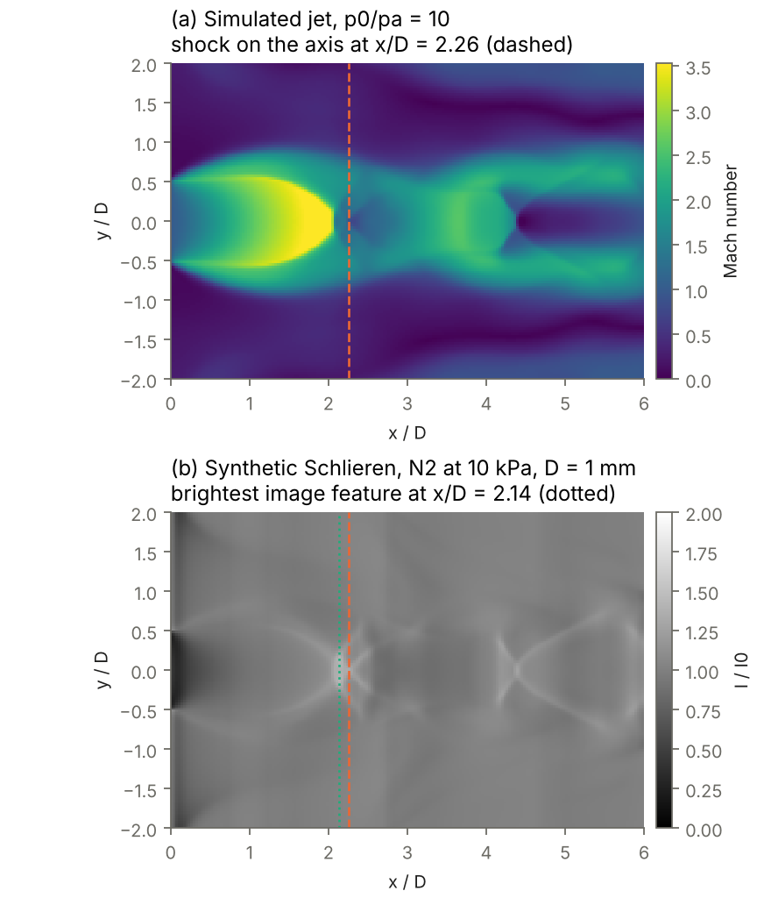
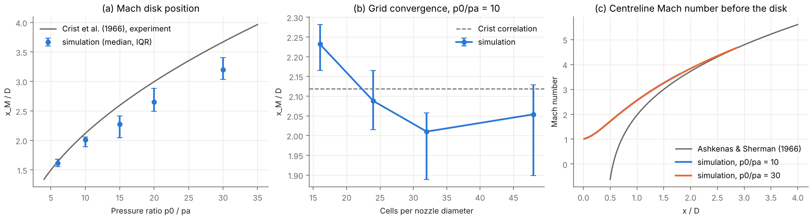
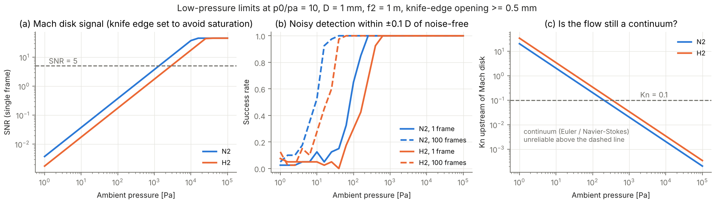
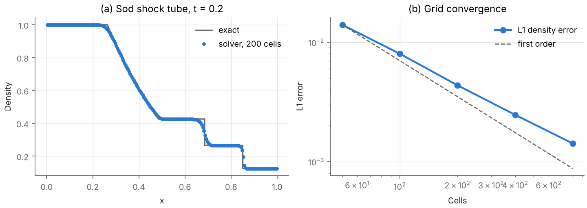

# Schlieren Jet Sim

How low can the ambient pressure go before a Schlieren system can no longer see the shock structure of a supersonic gas jet?

This project builds the full measurement chain in simulation: a compressible-flow solver that produces underexpanded jets, a physical model of a Z-type Schlieren system with a knife edge and a noisy camera, and automated image analysis that extracts the Mach disk position. Each stage is validated against an independent reference before it is used.



## Results

**1. The solver reproduces the physics, and its limits are quantified.** The on-axis Mach number in the expanding jet core follows the Ashkenas–Sherman correlation beyond x/D ≈ 1.5, where that correlation applies. The Mach disk position agrees with the Crist et al. experiments to within 2–5% for p0/pa ≤ 10, and is 11–13% upstream at p0/pa = 15–30. At p0/pa = 10 it is grid-converged to within a few percent (2.23 → 2.09 → 2.01 → 2.05 for 16 → 48 cells per diameter). Doubling the radial extent of the domain at p0/pa = 20 moves the disk by only 2% (2.65 → 2.70), so the far-field boundaries are not the cause of the high-ratio offset.

| p0/pa | Simulated x_M/D (median, IQR) | Crist et al. (1966) | Difference |
|---|---|---|---|
| 6 | 1.62 (1.56–1.68) | 1.64 | −1.6% |
| 10 | 2.01 (1.89–2.06) | 2.12 | −5.1% |
| 15 | 2.28 (2.04–2.41) | 2.60 | −12.3% |
| 20 | 2.65 (2.49–2.88) | 3.00 | −11.4% |
| 30 | 3.20 (3.03–3.40) | 3.67 | −12.8% |



**2. A Schlieren image reads the Mach disk about 0.1 D upstream of where it sits on the axis.** The camera integrates through the whole jet, and the curved disk and barrel shocks put the brightest feature at x/D = 2.14 while the shock on the axis is at 2.26 (p0/pa = 10). Comparisons between Schlieren measurements and CFD should compare synthetic images, not axis values.

**3. At low pressure the optics can outlast the continuum model.** For a 1 mm nozzle at p0/pa = 10, with the knife edge opened only as far as needed to avoid saturation:

| | N2 | H2 |
|---|---|---|
| Per-pixel SNR = 5, single frame | 1.3 kPa | 2.8 kPa |
| 90% reliable detection, single frame | 185 Pa | 380 Pa |
| 90% reliable detection, 100 frames averaged | 15 Pa | 36 Pa |
| Continuum breaks down (Kn = 0.1 upstream of the disk) | below ~250 Pa | below ~400 Pa |

Hydrogen is harder to image (half the refractivity of nitrogen at equal pressure) and leaves the continuum regime sooner (longer mean free path). With frame averaging the Mach disk stays visible well below the pressure at which Euler or Navier–Stokes simulations stop being trustworthy, so in that regime the measurement would need rarefied-gas models (for example DSMC) to interpret.



**4. Debugging notes worth keeping.** Two numerical problems appeared and were fixed rather than tuned away. A zero-gradient far field let the ambient pressure drift, which moved the Mach disk; the far field now imposes ambient pressure where the outflow is subsonic. The HLLC flux then produced an unsteady, misplaced Mach disk, the classic carbuncle instability at a strong grid-aligned shock (Quirk, 1994); switching to the HLL flux removed it and moved the disk from about 18% to 5% from experiment at p0/pa = 10. HLLC remains available and is still validated, since it resolves contact waves more sharply.

## Method

### 1. Flow: axisymmetric Euler solver (`src/jetlab/euler.py`)

- Finite-volume solution of the compressible Euler equations in (x, r), γ = 1.4.
- HLL Riemann fluxes (HLLC available), MUSCL reconstruction with a minmod limiter, second-order Runge–Kutta time stepping (CFL 0.4).
- Axisymmetric form with face-radius-weighted radial fluxes and a p/r source term, so gas at rest stays exactly at rest.
- Sonic nozzle of diameter D at x = 0, stagnation temperature equal to ambient. Solid face plate around the nozzle, symmetry axis at r = 0, far-field boundaries that impose ambient pressure where the outflow is subsonic.
- Units: D, ambient density and pressure. Inviscid flow depends only on p0/pa, so one simulation serves every absolute ambient pressure.

### 2. Optics: synthetic Schlieren (`src/jetlab/optics.py`)

| Step | Model |
|---|---|
| Refractive index | Gladstone–Dale, n − 1 ∝ ρ, from refractivity at STP (N2 2.98e-4, H2 1.39e-4) |
| Line of sight | Exact forward Abel projection of the axisymmetric field (piecewise-constant annuli) |
| Deflection | ε = ∂/∂x ∫(n − 1) dz, knife edge vertical so the Mach disk (a normal shock) stands out |
| Knife edge | I/I0 = 1 + f2 ε / a, clipped to [0, 2] for a half cut-off |
| Camera | Poisson shot noise plus 5 e⁻ read noise, background at 10,000 e⁻; frame averaging |

Assumed set-up: nozzle D = 1 mm, f2 = 1 m, unobstructed source image a = 0.5 mm, T = 293 K, pixel size equal to the solver cell (D/32 ≈ 31 µm). These are typical laboratory values, not any specific facility.

### 3. Analysis (`src/jetlab/analysis.py`)

- Ground truth: the steepest density rise on the axis just downstream of supersonic flow, with sub-cell parabolic refinement.
- From images: brightest feature in the near-axis rows (|y| ≤ D/4) after Gaussian smoothing, the way an automated pipeline would see it.
- Noise robustness: a detection counts as successful within ±0.1 D of the noise-free image detection, over 40 noise realisations per pressure; the knife-edge opening is widened when needed to avoid saturation.

## Validation

`pytest` runs 21 tests:

- **Flow solver:** Sod shock tube against the exact Riemann solution with both fluxes; a Mach ~200 shock (Toro test 3) stays positive and accurate; error decreases under grid refinement; x and r directions give identical results; mass and energy are conserved to machine precision; axisymmetric gas at rest stays at rest.
- **Optics:** Abel projection of a Gaussian matches the analytic result; uniform-disk chords are exact; N2 refractivity at room conditions, H2/N2 ratio, the N2 mean free path at 1 atm, knife-edge linearity and saturation, and camera noise statistics including frame averaging.
- **Analysis:** detectors recover a known shock position with sub-cell accuracy, pick the first shock rather than the strongest, ignore compressions in subsonic flow, and find a line in a noisy image.



## Run it

```bash
pip install -e ".[dev]"
pytest                                   # ~10 s
python examples/run_sweep.py sweep       # pressure-ratio sweep (~30 min on 2 cores)
python examples/run_sweep.py convergence # grid convergence at p0/pa = 10
python examples/make_figures.py          # figures/ and a numeric summary
```

## Limitations

- **Inviscid, continuum flow.** No viscosity, so the shear layer and its unsteadiness are only captured numerically. At low pressure the continuum assumption itself fails (figure 5c), which is exactly the regime where Euler and Navier–Stokes results stop being trustworthy and particle methods such as DSMC are needed.
- **Idealised optics.** No diffraction, source extent beyond the knife-edge model, lens aberrations or vibration; real systems have more noise sources, so the detection limits here are optimistic.
- **Time-resolved structure.** The Mach disk oscillates in the simulation; positions are reported as the median and interquartile range of 28 samples between t = 16 and 30 (units D / ambient sound speed), and images use a single instantaneous snapshot.
- **Systematic offset at high pressure ratio.** The 11–13% upstream bias for p0/pa ≥ 15 is not fully explained; a wider domain changes it by only 2%, so the remaining candidates are the inviscid model, numerical dissipation in the shear layer, and the finite averaging window.
- **Single gas per run.** Hydrogen and nitrogen differ in refractivity and mean free path, which is modelled, but the flow solution is the same for both since both have γ = 1.4.

## Structure

```
src/jetlab/euler.py      flow solver
src/jetlab/riemann.py    exact Riemann solution (validation reference)
src/jetlab/optics.py     Schlieren and camera model
src/jetlab/analysis.py   Mach disk detection, Crist correlation
tests/                   validation suite
examples/                simulation sweep and figure generation
figures/                 generated figures
```

## References

- J. J. Quirk, "A contribution to the great Riemann solver debate", *Int. J. Numer. Methods Fluids* 18, 1994.
- H. Ashkenas, F. S. Sherman, "The structure and utilization of supersonic free jets in low density wind tunnels", *Rarefied Gas Dynamics* 4, 1966.
- E. F. Toro, *Riemann Solvers and Numerical Methods for Fluid Dynamics*, 3rd ed., Springer, 2009.
- S. Crist, P. M. Sherman, D. R. Glass, "Study of the highly underexpanded sonic jet", *AIAA Journal* 4(1), 1966.
- G. S. Settles, *Schlieren and Shadowgraph Techniques*, Springer, 2001.
